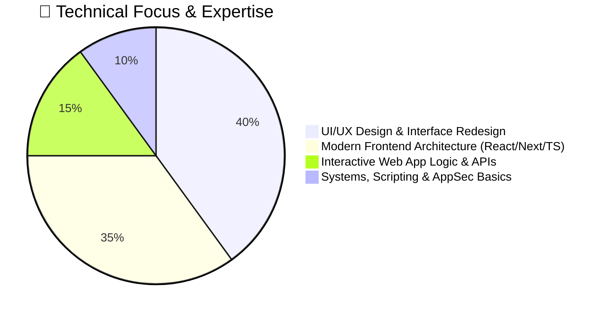
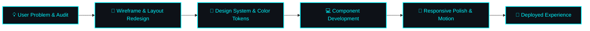

<!-- TOP STATUS BADGES -->

  

<!-- HERO ANIMATED GRADIENT BANNER -->

 

<!-- DYNAMIC TYPING SVG -->

  

<!-- QUICK NAVIGATION DOCK -->

  
  
  
  
  
  
  

---

## 🧑‍💻 About Me & My Evolution

<table>
  <tr>
    <td width="30%" align="center" valign="middle">
      
        
      
       
      
    </td>
    <td width="70%" valign="top">
      <h3>✨ Elevating Digital Experiences Through Code & Design</h3>
      

        I'm <strong>Praveen M</strong>, a creative frontend engineer currently <strong>transitioning into my 4th year of B.E. Computer Science Engineering</strong> at <strong>SKP Engineering College</strong> (2023–2027) in Tamil Nadu, India.
      

      

        My journey in tech is driven by an obsession with <strong>UI design, visual transformation, and interface redesign</strong>. I love taking cluttered, legacy layouts and reimagining them into modern, fluid, and human-centric web applications. Combining strong JavaScript/TypeScript architecture with thoughtful design aesthetics, I build digital products that feel as good as they look.
      

      <table>
        <tr>
          <td>🎓 <strong>Academic Milestone</strong></td>
          <td><strong>B.E. Computer Science & Engineering</strong> — Transitioning to 4th (Final) Year @ SKP Engineering College</td>
        </tr>
        <tr>
          <td>🎨 <strong>Core Passion</strong></td>
          <td>UI/UX Design, Interface Redesigns, Design Systems & Modern Frontend Engineering</td>
        </tr>
        <tr>
          <td>💼 <strong>Practical Experience</strong></td>
          <td>1+ Year crafting responsive web platforms, dynamic layout editors & productivity suites</td>
        </tr>
        <tr>
          <td>📍 <strong>Based In</strong></td>
          <td>Tiruvannamalai, Tamil Nadu, India 🇮🇳</td>
        </tr>
        <tr>
          <td>🌐 <strong>Languages</strong></td>
          <td>English & Tamil (Fluent Professional Proficiency)</td>
        </tr>
        <tr>
          <td>💡 <strong>Guiding Philosophy</strong></td>
          <td><em>"Design with empathy, code with precision, deliver with impact."</em> 🚀</td>
        </tr>
      </table>
    </td>
  </tr>
</table>

---

## 🎨 UI/UX & Interface Redesign Philosophy

  
<em>Transforming complex interactions into frictionless, visually stunning, and user-centric interfaces.</em>

<table>
  <tr>
    <td width="50%" valign="top">
      <h3 align="center">👁️ 1. Visual Hierarchy & Typography</h3>
      

        Effective UI isn't just decoration — it's communication. I implement clear typographic scale, intentional whitespace, and curated color palettes that guide user focus directly to high-value actions without cognitive fatigue.
      

      

        
        
        
      

    </td>
    <td width="50%" valign="top">
      <h3 align="center">⚡ 2. Friction Reduction & Flow</h3>
      

        When redesigning existing systems, my priority is identifying user pain points. By simplifying multi-step forms, streamlining navigation drawers, and adding context-aware feedback, apps become effortless to navigate.
      

      

        
        
        
      

    </td>
  </tr>
  <tr>
    <td width="50%" valign="top">
      <h3 align="center">📱 3. Fluid Responsive Architecture</h3>
      

        Modern interfaces must adapt seamlessly. I design with a mobile-first philosophy, employing modern CSS Grid, Flexbox, and fluid typography to deliver consistent polish across smartphones, tablets, and ultra-wide desktop monitors.
      

      

        
        
        
      

    </td>
    <td width="50%" valign="top">
      <h3 align="center">♿ 4. Accessibility & Inclusive Usability</h3>
      

        True design excellence includes everyone. I champion WCAG color contrast standards, semantic HTML elements, keyboard navigability, and clear interactive focus rings so every user enjoys a barrier-free experience.
      

      

        
        
        
      

    </td>
  </tr>
</table>

 

### 🔄 The Interface Redesign Mindset

| Dimension | Legacy / Cluttered Interface | Modern Human-Centered UI (My Approach) |
|:---|:---|:---|
| **Visual Structure** | Dense walls of text, unorganized buttons, weak contrast | Clean card architecture, bold focal points, intentional breathing room |
| **Color Strategy** | Random, clashing colors with inconsistent styling | Curated gradient accents, harmonious HSL palettes, cohesive dark mode |
| **Navigation** | Multi-level buried menus and confusing nested links | Quick-dock actions, sticky persistent headers, intuitive breadcrumbs |
| **User Feedback** | Static, silent clicks with uncertain loading states | Instant micro-interactions, optimistic state updates, crisp transitions |

---

## 🧰 Technology Arsenal & Toolchain

  
<em>Curated technologies and design tools verified across my projects and codebase.</em>

  <!-- SKILLICONS DYNAMIC RIBBON -->
  

 

### 📈 Engineering & Design Breakdown

 

### 🎨 Categorized Technologies & Badges

#### 🎨 UI/UX & Frontend Engineering

 

#### ⚙️ Programming, Scripting & Backend

 

#### 🛡️ Web Security Awareness & Systems

 

#### 🧰 Development Tools & Environments

---

## 🚀 Featured Projects & Redesign Showcase

  
<em>Real applications reflecting my focus on intuitive layouts, modern aesthetics, and solid engineering.</em>

<!-- ROW 1 -->
<table>
  <tr>
    <!-- PROJECT 1: CERTIFICATE STUDIO -->
    <td width="50%" valign="top">
      <h3 align="center">📜 <a href="https://github.com/praveeen2025/Certificate-Studio">Certificate Studio</a></h3>
      

        
        
          
        

          A dedicated <strong>design and layout studio for credential generation</strong>. Features a visual drag-and-drop canvas, customizable typography and styling controls, reusable template structures, and direct high-resolution vector PDF/image export.
        

        

          🎨 <strong>WYSIWYG Canvas:</strong> Interactive element manipulation with alignment guides 
          📐 <strong>Template Hierarchy:</strong> Clean layout system for academic and corporate credentials 
          🖨️ <strong>Export Engine:</strong> Instant vector PDF rendering with zero resolution loss
        

        
<strong>🛠️ Stack:</strong> Next.js · React · HTML5 Canvas · SVG · CSS3

        
        
      

    </td>
    <!-- PROJECT 2: RAIN CODE STUDIO -->
    <td width="50%" valign="top">
      <h3 align="center">🤖 <a href="https://github.com/praveeen2025/Rain-Code-Studio">Rain Code Studio</a></h3>
      

        
        
          
        

          A <strong>privacy-first AI developer studio</strong> engineered specifically for Snapdragon-powered PCs. Employs local AI models and codebase-aware RAG to understand codebases, detect bugs, generate tests, and display clean visual diff reviews.
        

        

          🧠 <strong>Codebase RAG:</strong> Offline context mapping without cloud telemetry 
          🛡️ <strong>Visual Diff UI:</strong> Clean side-by-side comparison before accepting edits 
          ⚡ <strong>Developer Scaffolding:</strong> Automated unit tests and markdown docs
        

        
<strong>🛠️ Stack:</strong> TypeScript · Local AI · RAG · Snapdragon

        
        
      

    </td>
  </tr>
  <tr>
    <!-- PROJECT 3: BACHELORS FITNESS & FOOD -->
    <td width="50%" valign="top">
      <h3 align="center">🏋️ <a href="https://github.com/praveeen2025/uiux">Bachelors Fitness & Food Platform</a></h3>
      

        
        
          
        

          A full-stack <strong>lifestyle and health management application</strong> crafted with an intuitive dark UI tailored for bachelors and students. Eliminates friction in daily meal planning, workout scheduling, and habit tracking.
        

        

          🥗 <strong>Budget Meal System:</strong> Nutrition plans calculated for student living 
          💪 <strong>Workout Progression:</strong> Visual routine tracker for bodyweight & gym training 
          📱 <strong>Mobile-First Interface:</strong> Modern high-contrast dark aesthetic
        

        
<strong>🛠️ Stack:</strong> HTML5 · CSS3 · JavaScript · Responsive Design

        
        
      

    </td>
    <!-- PROJECT 4: SMART TASK MANAGER -->
    <td width="50%" valign="top">
      <h3 align="center">✅ <a href="https://github.com/praveeen2025/smart-todo-list">Smart Task Manager</a></h3>
      

        
        
          
        

          A high-speed <strong>daily productivity and task organizer</strong> designed with zero visual clutter. Features instant state filtering, priority badge color coding, and persistent local storage caching.
        

        

          ⚡ <strong>Persistent Caching:</strong> Zero data loss on refresh via LocalStorage 
          🏷️ <strong>Visual Prioritization:</strong> Color-coded urgency and deadline sorting 
          ✨ <strong>Micro-Interactions:</strong> Fluid CSS animations on task completion
        

        
<strong>🛠️ Stack:</strong> JavaScript · CSS Grid · LocalStorage

        
      

    </td>
  </tr>
</table>

<!-- PROJECT 5: GHOST HUNTER -->
<table width="100%">
  <tr>
    <td width="100%" valign="top">
      <h3 align="center">👻 <a href="https://github.com/praveeen2025/ghose-hunter-">Ghost Hunter Security Engine</a></h3>
      

        
        
        
          
        

          A Python-powered reconnaissance and evaluation tool crafted for structured security scans, endpoint probing, and vulnerability discovery automation.
        

        
      

    </td>
  </tr>
</table>

---

## 🎓 Academic Journey & Experience

| Degree / Role | Institution / Context | Timeline | Status |
|:---|:---|:---:|:---:|
| 🎓 **B.E. Computer Science & Engineering** | **SKP Engineering College**, Tamil Nadu | 2023 – 2027 | 🟡 **Transitioning to 4th Year** |
| 💻 **Junior Web Developer & UI Craftsman** | Modern Web Applications & Interface Redesigns | 2024 – 2026 | 🟢 **Active Experience** |

 

### 🚀 Key Focus Areas for My Final Year
- 🎨 **Mastering Design Systems:** Developing reusable token-based component libraries with Figma & Tailwind CSS.
- ⚡ **Full-Stack Interface Architecture:** Deepening expertise in Next.js Server Components, React hooks, and fluid web animations.
- ♿ **Accessible & High-Performance Web:** Building sites scoring 95+ across Google Lighthouse metrics for performance, accessibility, and SEO.
- 🛡️ **Defensive Frontend Security:** Enforcing strict client-side validation, sanitized state handling, and secure web storage workflows.

---

## 📊 GitHub Metrics & Analytics

  
<em>Real-time development activity, repository metrics, and languages from my active GitHub profile.</em>

  <!-- REPUTATION BADGES -->
  
  
  

    

  <!-- STATS CARDS -->
  <table>
    <tr>
      <td width="50%" align="center">
        
      </td>
      <td width="50%" align="center">
        
      </td>
    </tr>
  </table>

   

  <!-- STREAK STATS -->
  

    

  <!-- CONTRIBUTION ACTIVITY HEATMAP GRAPH -->
  <h4>⚡ Real-time GitHub Contribution Heatmap</h4>
  

---

## 🌐 Connect & Collaborate

  
<em>Looking for a frontend developer passionate about UI/UX, interface redesigns, or exciting engineering challenges? Let's talk!</em>

  

  

  

  

    

  ### 🌍 Location
  

   

  ### 💼 Open for Opportunities
  
  
  

---

  

  <h3>💡 <em>"Design with empathy, code with precision, deliver with impact."</em> ✨</h3>

  

