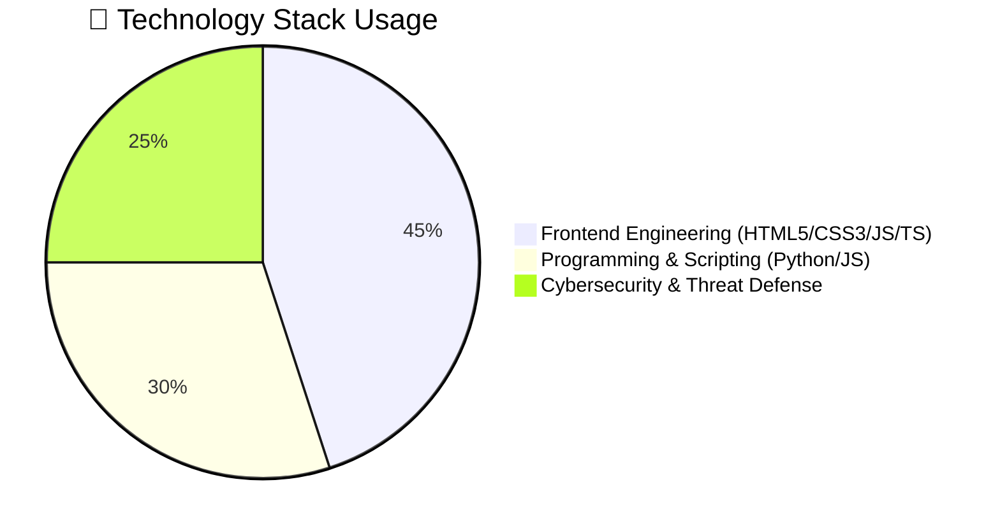
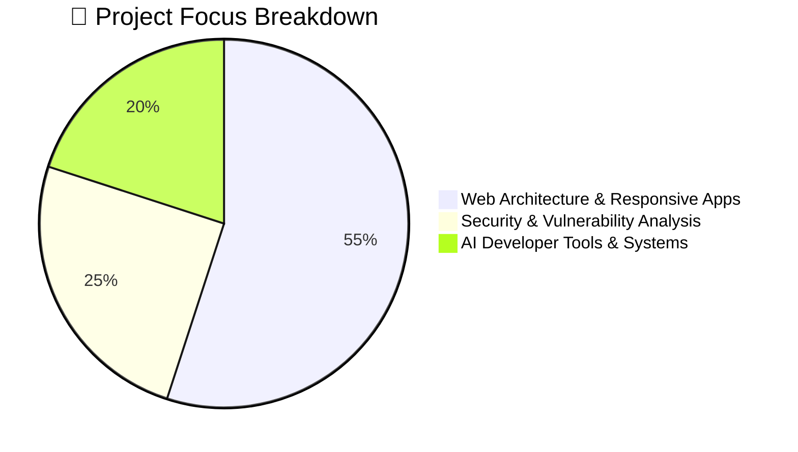
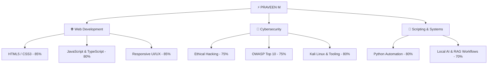

<!-- TOP STATUS BADGES -->

  

<!-- HERO ANIMATED BANNER -->

 

<!-- DYNAMIC TYPING SVG -->

  

<!-- QUICK NAVIGATION DOCK -->

  
  
  
  
  
  

---

## 🧑‍💻 About Me

<table>
  <tr>
    <td width="32%" align="center" valign="middle">
      
        
      
       
      
    </td>
    <td width="68%" valign="top">
      <h3>⚡ Executive Developer & Security Dossier</h3>
      

        I'm <strong>Praveen M</strong>, a driven <strong>Junior Web Developer</strong> and <strong>Cybersecurity Enthusiast</strong> pursuing my <strong>B.E. in Computer Science Engineering</strong> at <strong>SKP Engineering College</strong> (3rd Year, 2023–2027) in Tamil Nadu, India.
      

      

        Currently advancing practical defensive and offensive security as a <strong>Cybersecurity Intern at CyberWolf Company</strong> (<a href="https://cyberwolf.pro">cyberwolf.pro</a>). With <strong>1+ year of frontend development experience</strong>, I combine intuitive user interface engineering with robust web application security protocols.
      

      <table>
        <tr>
          <td>🎓 <strong>Academic Degree</strong></td>
          <td>B.E. Computer Science & Engineering (2023–2027) @ SKP Engineering College</td>
        </tr>
        <tr>
          <td>🛡️ <strong>Current Internship</strong></td>
          <td>Cybersecurity Intern @ <strong><a href="https://cyberwolf.pro">CyberWolf Company</a></strong> (Ongoing)</td>
        </tr>
        <tr>
          <td>💻 <strong>Core Experience</strong></td>
          <td>1+ Year Professional Experience Building Responsive, Secure Web Applications</td>
        </tr>
        <tr>
          <td>📍 <strong>Location Base</strong></td>
          <td>Tiruvannamalai, Tamil Nadu, India 🇮🇳</td>
        </tr>
        <tr>
          <td>🗣️ <strong>Languages Spoken</strong></td>
          <td>English & Tamil (Fluent)</td>
        </tr>
        <tr>
          <td>💡 <strong>Mission Motto</strong></td>
          <td><em>"Code with purpose, secure with passion, build with precision."</em> 🚀</td>
        </tr>
      </table>
    </td>
  </tr>
</table>

---

## 🧰 Technology Arsenal & Stack Distribution

  
<em>An interactive, high-visibility overview of technical proficiencies, development frameworks, and security analysis tools.</em>

  <!-- SKILLICONS DYNAMIC RIBBON -->
  

 

### 📈 Visual Stack & Project Focus Distribution

 

### 🎨 Categorized Technology Matrix

#### 🌐 Frontend & UI Engineering

 

#### 🔐 Cybersecurity & Defensive Operations

 

#### 🐍 Programming Languages & AI Workflows

 

#### ⚙️ Developer Tools & Environments

 

### 📊 Competency Hierarchy Graph

---

## 🚀 Featured Projects & Innovations

  
<em>Selected software engineering solutions, security utilities, and developer studio applications.</em>

<!-- ROW 1 OF PROJECTS -->
<table>
  <tr>
    <!-- PROJECT 1 -->
    <td width="50%" valign="top">
      <h3 align="center">🤖 <a href="https://github.com/praveeen2025/Rain-Code-Studio">Rain Code Studio</a></h3>
      

        
        
          
        

          A <strong>privacy-first AI developer studio</strong> crafted for Snapdragon PCs. Leverages local AI and codebase-aware RAG to understand software projects, detect bugs, generate automated tests, and suggest code changes with user-controlled diff workflows.
        

        

          ✅ <strong>Codebase RAG:</strong> Offline project understanding with zero cloud telemetry 
          ✅ <strong>Visual Diff Review:</strong> Complete developer control over every code edit 
          ✅ <strong>Automated QA:</strong> On-demand test suite & documentation generator
        

        
<strong>🛠️ Stack:</strong> TypeScript · Local AI · RAG · Snapdragon

        
        
      

    </td>
    <!-- PROJECT 2 -->
    <td width="50%" valign="top">
      <h3 align="center">📜 <a href="https://github.com/praveeen2025/Certificate-Studio">Certificate Studio</a></h3>
      

        
        
          
        

          An intuitive, web-based <strong>certificate design studio and layout generator</strong>. Built with interactive drag-and-drop canvas editing, custom typography formatting, and high-fidelity vector PDF & image export pipelines.
        

        

          ✅ <strong>Interactive Canvas:</strong> Drag-and-drop positioning with alignment guides 
          ✅ <strong>Multi-Format Output:</strong> Vector-sharp PDF and high-res image generation 
          ✅ <strong>Template System:</strong> Reusable certificate layouts for events and courses
        

        
<strong>🛠️ Stack:</strong> Next.js · React · HTML5 Canvas · SVG

        
        
      

    </td>
  </tr>
  <tr>
    <!-- PROJECT 3 -->
    <td width="50%" valign="top">
      <h3 align="center">🏋️ <a href="https://github.com/praveeen2025/uiux">Bachelors Fitness & Food</a></h3>
      

        
        
          
        

          A dedicated <strong>health and fitness management platform</strong> engineered specifically for bachelors and students. Features customized workout schedules, budget-friendly meal suggestions, and real-time fitness metric logs.
        

        

          ✅ <strong>Budget Meal Planner:</strong> Nutrition-rich meal recipes suited for students 
          ✅ <strong>Workout Routine Engine:</strong> Calisthenics & gym training tracking 
          ✅ <strong>Clean Responsive UI:</strong> Mobile-first dark theme interface
        

        
<strong>🛠️ Stack:</strong> HTML5 · CSS3 · JavaScript

        
        
      

    </td>
    <!-- PROJECT 4 -->
    <td width="50%" valign="top">
      <h3 align="center">✅ <a href="https://github.com/praveeen2025/smart-todo-list">Smart Task Manager</a></h3>
      

        
        
          
        

          A high-efficiency <strong>productivity and task management suite</strong>. Built to eliminate daily cognitive load with priority filtering, instant status categorizations, and persistent client-side data synchronization.
        

        

          ✅ <strong>Persistent Storage:</strong> Zero data loss on refresh with LocalStorage 
          ✅ <strong>Priority Filtering:</strong> Instant grouping by urgency and deadlines 
          ✅ <strong>Fluid Interactions:</strong> Micro-animations for task actions
        

        
<strong>🛠️ Stack:</strong> JavaScript · CSS Grid · LocalStorage

        
      

    </td>
  </tr>
</table>

<!-- PROJECT 5 (SECURITY TOOLKIT) -->
<table width="100%">
  <tr>
    <td width="100%" valign="top">
      <h3 align="center">👻 <a href="https://github.com/praveeen2025/ghose-hunter-">Ghost Hunter Security Engine</a></h3>
      

        
        
        
          
        

          A Python-powered security automation utility engineered for reconnaissance, endpoint probing, and vulnerability discovery workflows. Tailored for ethical hackers and penetration testers conducting structured application security assessments.
        

        
      

    </td>
  </tr>
</table>

---

## 💼 Professional Experience & Apprenticeship

| Role | Organization | Period | Status |
|:---|:---|:---:|:---:|
| 🛡️ **Cybersecurity Intern** | [CyberWolf Company](https://cyberwolf.pro) | Ongoing | 🟢 Active |
| 💻 **Junior Web Developer** | Client & Web Solutions | 2024 – 2026 | 🟢 Active |

 

### 🔐 Cybersecurity Intern — CyberWolf Company *(Ongoing)*
- 🛡️ Gaining hands-on experience in **web security**, ethical hacking, and vulnerability assessments
- 🔍 Analyzing web applications against the **OWASP Top 10** vulnerabilities (XSS, SQLi, CSRF, broken access control)
- 🧪 Performing practical security probing using Kali Linux tools, network recon utilities, and manual testing
- 🔗 Company Website: [https://cyberwolf.pro](https://cyberwolf.pro)

### 💻 Junior Web Developer *(2024 – 2026)*
- 🌐 Engineered responsive, accessible websites ensuring cross-device compatibility and performance
- 🔧 Delivered reliable frontend solutions using modular CSS3 and clean modern JavaScript (ES6+)
- 📱 Implemented mobile-first designs with fast loading speeds and strict client-side validation
- 🚀 Contributed to end-to-end frontend development for practical client and web portal projects

---

## 🎓 Education & Credentials

| Degree / Program | Institution | Duration | Academic Status |
|:---|:---|:---:|:---:|
| 🎓 **B.E. Computer Science Engineering** | **SKP Engineering College** | 2023 – 2027 | 🟡 3rd Year (Ongoing) |

---

## 📊 GitHub Metrics & Analytics

  
<em>Live telemetry, repository analytics, and contribution activity from my GitHub account.</em>

  <!-- BADGES -->
  
  
  

    

  <!-- STATS CARDS -->
  <table>
    <tr>
      <td width="50%" align="center">
        
      </td>
      <td width="50%" align="center">
        
      </td>
    </tr>
  </table>

   

  <!-- STREAK STATS -->
  

    

  <!-- CONTRIBUTION ACTIVITY HEATMAP GRAPH -->
  <h4>⚡ Real-time GitHub Contribution Heatmap</h4>
  

---

## 🌐 Connect & Collaborate

  
<em>Looking for a passionate web developer or cybersecurity intern for innovative builds? Reach out!</em>

  

  

  

  

  

    

  ### 🌍 Location
  

   

  ### 💼 Open for Opportunities
  
  
  

---

  

  <h3>💡 <em>"Code with purpose, secure with passion, build with precision."</em></h3>

  

